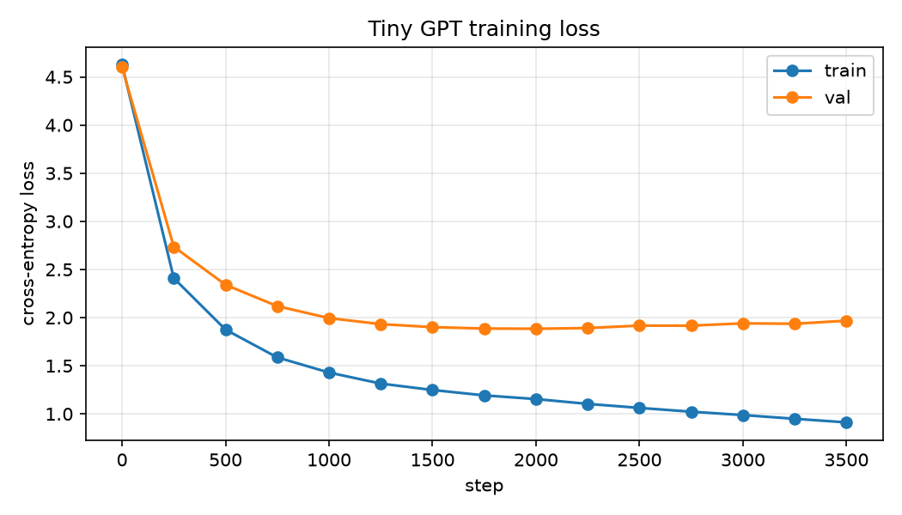

# Tiny GPT: a character-level GPT trained on Bulfinch's Mythology

A ~10.8M-parameter decoder-only Transformer, written in PyTorch and trained from scratch on Bulfinch's *Mythology*. [Live demo](TODO_HF_SPACE_URL)

<!-- TODO: add a demo screenshot at assets/demo.png, then uncomment -->
<!--  -->

## What it is (and isn't)

- **Is:** a base language model. Given a prompt, it predicts the next character, over and over, so it continues the text in the style of the book.
- **Is not:** a chatbot or an assistant. It has no instruction tuning, doesn't follow instructions, and doesn't answer questions reliably. Output is book-flavoured, locally plausible text with invented words and facts.

## Model

| Setting | Value |
|---|---|
| Type | Decoder-only Transformer, pre-LayerNorm, ReLU MLP |
| Layers | 6 |
| Attention heads | 6 (head size 64) |
| Embedding size (`n_embd`) | 384 |
| Context length (`block_size`) | 256 characters |
| Vocabulary | 90 characters (character-level, no BPE) |
| Dropout | 0.2 |
| Parameters | 10,808,154 (10.81M) |
| Default checkpoint | `checkpoints/mythology_model_v2.pt` (`state_dict`, 52.75 MB, includes causal-mask buffers) |

Training setup (defaults of `train.py`): AdamW, learning rate 3e-4, batch size 64, up to 5000 iterations, seed 1337, evaluation every 250 steps (200 batches per split), early stopping with patience 6. The v2 run used CUDA on an RTX 4060 Laptop GPU.

## Dataset

Bulfinch's *Mythology* (public domain), in `data/input.txt`: 839,083 characters, 90 unique. Split 90/10 by position: 755,174 characters train, 83,909 validation.

## Results



| Checkpoint | Train loss | Val loss | Selected how |
|---|---|---|---|
| v1 `mythology_model.pt` (original) | 0.7035 | 2.2389 | final weights of a 5000-step run |
| **v2 `mythology_model_v2.pt` (default)** | 1.1476 | **1.8911** | best val loss during training (step 2000) |

Both rows come from `python evaluate.py --checkpoint <ckpt> --eval_iters 40 --batch_size 32` (seed 1337, random 256-character windows). The v1 row assumes that checkpoint was trained on the same 90/10 split. During training v2's logged best was val 1.8840 (train 1.1537) at step 2000 (`checkpoints/mythology_model_v2_loss.csv`); the evaluate numbers differ slightly because they use different random windows.

The validation set was also used to choose the v2 checkpoint and the stopping point, so the v2 val number is slightly optimistic. There is no separate test set.

## Overfitting

The original checkpoint (v1) trained for a fixed 5000 steps and kept the final weights. By the end it had memorised much of the small training text: train loss 0.70 versus val loss 2.24.

The v2 run keeps the architecture, dropout and hyperparameters identical and changes only how training is stopped and which weights are kept:

- Evaluate every 250 steps and save weights only when val loss improves.
- Stop after 6 evaluations with no improvement.

In the loss curve, val loss reaches its minimum (1.8840) at step 2000 and then rises while train loss keeps falling (0.91 by step 3500), which is the classic overfitting signature. Training stopped at step 3500 and the step-2000 weights were kept. Result: val loss 2.24 to 1.89 (about 16% lower), with a higher train loss (0.70 to 1.15), meaning less memorisation.

This reduces overfitting but doesn't remove it. The root cause is about 0.84M characters of data for a 10.8M-parameter model; more data or regularisation would be needed to go further.

## Sample outputs

Unedited, 300 new characters each (full set and exact settings in [assets/samples.md](assets/samples.md); v1 samples are kept in [assets/samples_v1.md](assets/samples_v1.md)). v2, prompt "Zeus", temperature 0.5, top-k 40:

```text
Zeus was done with his son who had been some seen that
he hero contained to rest the ship of the sight. He was so a companion of
the followers of the same sacred that the mind of the shore, and with
his body of the early sails with the sea, which he saw the sea, she
approached the shores of the Greeks. 
```

v2, prompt "The hero set out", temperature 0.8, top-k 40:

```text
The hero set out of his banks, and viewed him from
the Midgard, who is should be prevailed to the minotal. He old received on the
northern he body out of the destroy and rivers, and take it with a
serpent. He is the part of the sea, when he tried to his brother, and at
last fell over sudden in the skilful of the Cy
```

v2, prompt "In the beginning", temperature 1.2, no top-k (note the degeneration at high temperature):

```text
In the beginnings dulcomd Siegfried, and
quitors, of all hunts. A midst enclosed with their divincies
ensually may encountered to Thialfi, it was expeditful for couche drink.
These king, raying to HYgmsolvemnon issued, Mrsia ambrosially
detained by Anubis
```

Honest note: with the same prompts and seeds, the v1 samples read as *more* fluent than v2's. That is the overfitting at work: v1 reproduces memorised phrasing from the training text, while v2 is vaguer and more generic but generalises better by validation loss.

## Quickstart

```bash
pip install -r requirements.txt
# For GPU training, install a CUDA build of PyTorch instead (see https://pytorch.org/get-started/locally/)

# Generate text from the default checkpoint (v2)
python generate.py --prompt "Zeus" --max_new_tokens 300 --temperature 0.8 --top_k 40

# Run the Gradio demo (CPU is fine)
python app.py

# Retrain (best-val checkpoint + CSV loss log; refuses to overwrite without --force)
python train.py --out checkpoints/run3.pt
pip install -r requirements-dev.txt
python plot_loss.py --log checkpoints/run3_loss.csv --out assets/loss_curve.png

# Evaluate a checkpoint
python evaluate.py --checkpoint checkpoints/run3.pt
```

Training on CPU is very slow; the v2 run took about 46 minutes (to the step-3500 early stop) on an RTX 4060 Laptop GPU.

## Project structure

```
app.py                 Gradio demo (streaming, temperature, top-k, seed)
model.py               GPT model, config, character tokenizer, checkpoint loader
train.py               Training (CLI args, best-val checkpointing, early stopping, CSV log)
generate.py            CLI text generation
evaluate.py            Train/val loss of a checkpoint
plot_loss.py           Plot loss curve from a train.py log
make_samples.py        Regenerates a samples file from a checkpoint
data/input.txt         Training corpus
checkpoints/           v1 and v2 weights, v2 loss log
notebooks/             Original development notebook
experiments/           01_bigram.py, 02_gpt_v2.py (the original step-by-step scripts)
assets/                Loss curve and sample outputs
DEPLOY.md              Hugging Face Spaces deployment steps
```

## What I learned / limitations

- **Character-level tokenization** keeps the vocabulary tiny but makes sequences long and forces the model to learn spelling; it invents plausible non-words ("minotal", "divincies").
- **Tiny data** (about 0.84M characters) is far too little for 10.8M parameters; the train/val gap is the result.
- **Overfitting** is real even after early stopping (train 1.15 vs val 1.89).
- **No instruction following:** it only continues text. Prompts like questions get book-style continuations, not answers.
- Coherence is local, and long-range facts are unreliable.

## Future work

- BPE tokenizer instead of characters.
- Ablations on context length, number of layers and dropout.
- More data and stronger regularisation; hold out a separate test set.
- Fine-tune on a small instruction set.

## Credits

Built following Andrej Karpathy's ["Let's build GPT: from scratch, in code, spelled out"](https://www.youtube.com/watch?v=kCc8FmEb1nY) and his [nanoGPT](https://github.com/karpathy/nanoGPT).
